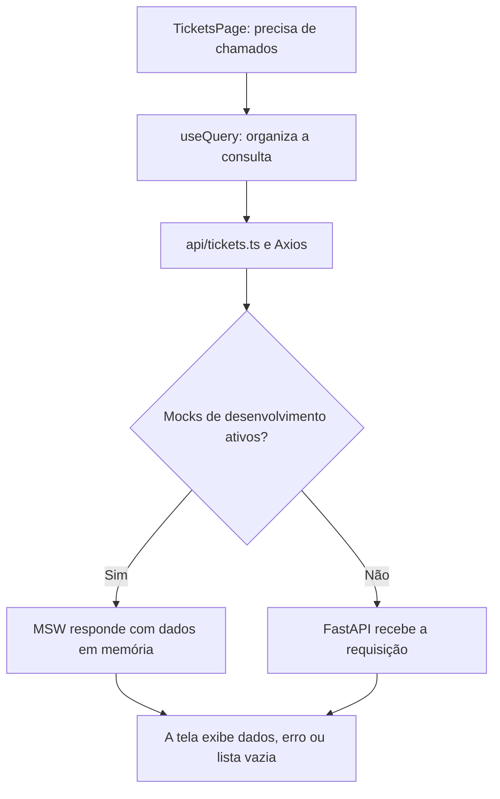

# HelpDesk: entendendo o frontend do zero

Este guia explica o frontend do seu Capstone 2 com linguagem simples. A ideia é que você entenda o que cada peça faz antes de conectar seu backend FastAPI.

A explicação está em português para facilitar o estudo. A interface da aplicação continua em inglês.

O guia foi baseado no arquivo `capstone_02_frontend(1).zip`. Ele explica a versão enviada, incluindo as pendências encontradas na revisão. Os pequenos exemplos marcados como didáticos servem para ensinar; não são arquivos adicionais do projeto.

## 1. O que estamos construindo?

Imagine uma escola com uma sala de suporte técnico. Quando um computador quebra, alguém preenche uma ficha pedindo ajuda. Um técnico pega essa ficha, conversa com quem pediu ajuda e resolve o problema.

O HelpDesk faz isso pela internet. A ficha se chama **ticket**, ou chamado.

Um chamado pode ter:

- **Title:** um título, como “Computer does not start”.
- **Description:** uma explicação do problema.
- **Category:** o tipo do problema, como hardware ou rede.
- **Priority:** a urgência.
- **Status:** a etapa do atendimento.
- **Created by:** quem abriu o chamado.
- **Assigned to:** quem está responsável por atender.
- **Comments:** as mensagens trocadas sobre o problema.

## 2. Frontend, backend e banco de dados

Pense em três partes trabalhando juntas:

| Parte | Comparação simples | No seu projeto |
| --- | --- | --- |
| Frontend | O balcão onde a pessoa faz o pedido e vê a resposta | A aplicação React aberta no navegador |
| Backend | A equipe que recebe o pedido, confere as regras e decide o que fazer | A API FastAPI que você vai implementar |
| Banco de dados | O arquivo organizado onde as fichas ficam guardadas | O banco que seu backend utilizará |

O frontend mostra um botão de excluir. O backend precisa decidir se aquela pessoa realmente pode excluir. O banco guarda o resultado da operação.

Esconder o botão ajuda a interface, mas não impede alguém de enviar uma requisição diretamente. Por isso, as permissões precisam ser verificadas no FastAPI também.

O navegador não deve acessar diretamente o banco de dados. Ele conversa com a API.

## 3. Como abrir o projeto

Abra um terminal na pasta `capstone_02_frontend`, onde está o arquivo `package.json`.

### Primeiro: instalar as peças necessárias

```bash
npm install
```

O projeto utiliza bibliotecas prontas. Esse comando instala essas bibliotecas na pasta `node_modules`.

O **Node.js** permite executar as ferramentas JavaScript de desenvolvimento. O **npm** instala pacotes e executa comandos definidos pelo projeto. O ambiente Python `.venv` não instala essas dependências do frontend.

### Segundo: escolher se vamos simular o backend

Se ainda não existe um `.env`, copie o modelo:

```bash
cp .env.example .env
```

Se o arquivo já existe, abra e edite o existente. Para experimentar as telas sem backend, deixe:

```env
VITE_API_BASE_URL=http://localhost:8000
VITE_ENABLE_MOCKS=true
```

### Terceiro: iniciar

```bash
npm run dev
```

Abra o endereço mostrado no terminal. Normalmente é:

```text
http://localhost:5173
```

Se a porta estiver ocupada, o endereço pode mudar. Use o que apareceu no terminal.

Mantenha esse terminal aberto. Para parar o servidor, pressione `Ctrl+C`. Se mudar o `.env`, reinicie o servidor para aplicar a configuração.

### Contas para experimentar os mocks

| Perfil | E-mail | Senha |
| --- | --- | --- |
| Customer | customer@example.com | customer123 |
| Support Agent | agent@example.com | agent123 |
| Administrator | admin@example.com | admin123 |

Essas contas pertencem à simulação. Elas não serão criadas automaticamente no seu banco FastAPI.

## 4. O que são mocks?

Um **mock** é uma simulação. É como ensaiar o atendimento da escola antes de a equipe real começar a trabalhar.

Neste projeto, o MSW intercepta as requisições no navegador e responde com dados de exemplo. A tela continua pedindo dados pelo Axios, mas, quando existe um handler correspondente, quem responde é a simulação.

Isso permite testar login, chamados e comentários antes de construir o backend.

| Arquivo | O que faz |
| --- | --- |
| `src/mocks/db.ts` | Guarda usuários, credenciais, chamados e comentários de exemplo em memória |
| `src/mocks/handlers.ts` | Define como responder a cada requisição simulada |
| `src/mocks/browser.ts` | Prepara o MSW para funcionar no navegador |
| `public/mockServiceWorker.js` | Arquivo do worker usado pelo MSW no navegador |
| `src/mocks/server.ts` | Prepara a interceptação para os testes executados fora do navegador |

O nome `server.ts` não significa que existe um backend pronto. Nesse caso, é infraestrutura de simulação para os testes.

Os dados do mock ficam em memória. Ao recarregar a aplicação, a simulação pode voltar aos dados iniciais. Isso é diferente de um banco persistente, que deve conservar os registros.

Nesta versão, o mock usa tokens de demonstração, como `mock-jwt-token-1`. Eles não são JWTs reais assinados. Seu backend precisará implementar a autenticação real.

Em produção, a versão revisada impede a ativação dos mocks mesmo com a flag configurada como `true`.

## 5. O que cada tecnologia faz?

| Tecnologia | Explicação simples |
| --- | --- |
| React | Monta a interface usando peças chamadas componentes |
| TypeScript | Ajuda a detectar valores e estruturas incompatíveis enquanto você programa |
| Vite | Serve a aplicação durante o desenvolvimento e prepara os arquivos para publicação |
| React Router | Escolhe qual tela aparece conforme o endereço do navegador |
| Axios | Envia pedidos HTTP para a API e recebe respostas |
| TanStack Query | Organiza consultas, carregamento, erros e dados guardados em cache |
| React Hook Form | Organiza campos e envio de formulários |
| Zod | Verifica regras dos valores, como tamanho mínimo de um título |
| Tailwind CSS | Define aparência e layout por classes de estilo |
| Lucide React | Fornece ícones para os componentes |
| MSW | Simula respostas da API |
| Vitest | Executa testes automatizados |
| React Testing Library | Ajuda os testes a interagir com componentes como uma pessoa faria |

Você não precisa dominar todas essas bibliotecas para implementar o FastAPI. Primeiro, entenda o que a tela envia e o que espera receber.

## 6. Arquivos que ficam na raiz

| Arquivo ou pasta | Para que serve |
| --- | --- |
| `package.json` | Lista bibliotecas e comandos do projeto |
| `package-lock.json` | Registra as versões resolvidas das dependências para instalações mais consistentes |
| `node_modules/` | Contém as dependências instaladas; normalmente você não edita essa pasta |
| `index.html` | É a página inicial que contém o espaço onde o React será montado |
| `vite.config.ts` | Configura Vite, plugins, testes e a remoção do worker da build |
| `tsconfig.json` | Aponta para as configurações TypeScript da aplicação e das ferramentas |
| `tsconfig.app.json` | Define a verificação TypeScript do código da aplicação |
| `tsconfig.node.json` | Define a verificação TypeScript das ferramentas de configuração |
| `.env` | Contém as configurações locais da sua execução |
| `.env.example` | Modelo das configurações necessárias |
| `.gitignore` | Informa ao Git quais arquivos devem ser ignorados |
| `.oxlintrc.json` | Configura o linter, que procura problemas e padrões suspeitos no código |
| `README.md` | Documentação geral de instalação e uso |
| `API_CONTRACT.md` | Descreve como o frontend espera conversar com o backend |
| `dist/` | Resultado da build: arquivos preparados para distribuição |
| `public/` | Arquivos estáticos que podem ser servidos diretamente |
| `src/` | Código-fonte da aplicação |

Uma configuração com prefixo `VITE_` pode ser incorporada ao código entregue ao navegador. Não coloque a chave secreta de assinatura JWT do FastAPI ali.

## 7. Como a aplicação começa

Quando você abre o endereço no navegador:

1. O navegador carrega `index.html`.
2. O código de `src/main.tsx` é executado.
3. `main.tsx` verifica se precisa iniciar os mocks.
4. Se a preparação der certo, o React monta `App.tsx` no elemento `root`.
5. `App.tsx` disponibiliza os serviços compartilhados e organiza as rotas.
6. A tela correspondente ao endereço é exibida.

Se o worker falhar, essa versão mostra uma mensagem de inicialização com um botão para tentar novamente.

### `main.tsx`: o botão de ligar

Ele inicia a aplicação. Não decide os detalhes de cada tela.

### `App.tsx`: o organizador

Ele conecta o roteamento, a autenticação, o tema, as notificações e as consultas.

O projeto também usa `StrictMode`, que ajuda a revelar problemas durante o desenvolvimento. Algumas execuções adicionais em desenvolvimento podem ser intencionais; isso não significa automaticamente que o backend está recebendo requisições duplicadas.

## 8. Páginas, componentes e layout

Uma **página** é uma tela completa. Um **componente** é uma peça que pode aparecer em várias telas.

Por exemplo: a tela de cadastro é uma página. O botão “Sign up” é um componente usado dentro dela.

### As páginas em `src/pages/`

| Arquivo | Endereço no frontend | Função |
| --- | --- | --- |
| `LoginPage.tsx` | `/login` | Entrar com e-mail e senha |
| `RegisterPage.tsx` | `/register` | Criar uma conta |
| `DashboardPage.tsx` | `/dashboard` | Mostrar números, chamados recentes e atalhos |
| `TicketsPage.tsx` | `/tickets` | Listar, buscar e filtrar chamados |
| `CreateTicketPage.tsx` | `/tickets/new` | Abrir um chamado |
| `TicketDetailsPage.tsx` | `/tickets/:ticketId` | Mostrar um chamado, comentários e ações permitidas |
| `UsersPage.tsx` | `/users` | Administrar usuários |
| `ProfilePage.tsx` | `/profile` | Mostrar informações do usuário autenticado |
| `ForbiddenPage.tsx` | `/forbidden` | Mostrar acesso negado |
| `NotFoundPage.tsx` | Endereço desconhecido | Mostrar que aquela página não existe |

Em `/tickets/:ticketId`, o trecho `:ticketId` é um espaço para um valor. Ao abrir `/tickets/7`, a tela trabalha com o chamado de ID 7.

### Peças em `src/components/`

| Grupo | Exemplos | Função |
| --- | --- | --- |
| `ui/` | Button, Input, Select, Textarea, Label | Botões, campos e seus rótulos |
| `ui/` | Card, Table, Badge | Caixas, tabelas e pequenas etiquetas de status |
| `ui/` | Modal | Janela sobre a página para editar ou confirmar uma ação |
| `layout/` | Sidebar, Header, AppLayout | Menu lateral, cabeçalho e organização geral das páginas |
| `feedback/` | Loading | Mostra que uma operação está carregando |
| `feedback/` | ToastContext | Mostra avisos temporários, como “Ticket created successfully” |
| `feedback/` | ErrorBoundary | Mostra uma alternativa quando ocorre um erro de renderização em componentes filhos |

O ErrorBoundary não substitui o tratamento de erros das requisições. Um pedido HTTP que falha também precisa ser tratado pela consulta ou pela operação que o iniciou.

`src/index.css` reúne estilos globais e a integração de estilos usada na entrada. `src/assets/` contém imagens que podem ser importadas pelos componentes. Um arquivo existir, como `App.css` ou uma imagem de exemplo, não garante que esteja sendo usado: é preciso verificar suas importações.

## 9. As pequenas ideias do React

### Componente

É uma função que descreve uma parte da tela. Exemplo didático:

```tsx
function Welcome() {
  return <h1>Welcome to HelpDesk</h1>;
}
```

Essa escrita parecida com HTML dentro do código se chama JSX. Arquivos TypeScript com JSX normalmente têm extensão `.tsx`.

### Props

São informações entregues a um componente. Exemplo didático:

```tsx
<Button disabled={true}>Save Changes</Button>
```

Aqui, `disabled` pede que o botão fique desativado. O texto entre as tags é o conteúdo do botão, chamado `children`.

### State

É a memória de uma parte da interface. Exemplo didático:

```tsx
const [isOpen, setIsOpen] = useState(false);
```

`isOpen` informa se uma janela está aberta. `setIsOpen(true)` pede ao React para atualizar esse estado e renderizar a interface correspondente.

Estado React não é banco de dados. Fechar ou recarregar a página pode perder esse estado.

### Hooks

São funções que conectam componentes a recursos do React ou de outras bibliotecas. Você verá nomes como `useState`, `useEffect`, `useAuth` e `useQuery`.

`useEffect` é usado para sincronizar o componente com algo externo, como um temporizador, um evento do navegador ou a classe de tema na página.

## 10. Context: informações compartilhadas

Imagine um quadro de avisos que várias salas conseguem consultar. Um **Context** permite compartilhar informações sem entregá-las manualmente por todos os componentes intermediários.

| Peça | Informação compartilhada |
| --- | --- |
| `AuthContext.tsx` | Quem está conectado, login, logout e estado de carregamento |
| `ThemeContext.tsx` | Tema claro, escuro ou do sistema |
| `ToastContext.tsx` | Funções para exibir notificações |

Um **Provider** disponibiliza essas informações para os componentes abaixo dele. `AuthProvider`, por exemplo, permite que uma página use `useAuth()` para consultar o usuário.

O tema é salvo no `localStorage`, um pequeno armazenamento do navegador. Nesta aplicação, o token também é armazenado ali. Os chamados do mock, por outro lado, ficam na memória de `db.ts`.

## 11. Rotas da página e rotas da API são diferentes

Compare:

| Endereço | O que acontece |
| --- | --- |
| `http://localhost:5173/tickets` | O navegador abre a tela de chamados |
| `http://localhost:8000/tickets` | A API recebe um pedido relacionado a chamados |

Mesmo que o caminho termine em `/tickets` nos dois casos, as funções são diferentes. A porta ajuda a indicar qual serviço você está acessando.

`localhost` significa o próprio computador. Pense em cada porta como uma entrada diferente nesse computador.

O React Router controla as páginas. O FastAPI controlará os endpoints do backend.

### Os guardas das telas

- `ProtectedRoute.tsx` espera a consulta de autenticação e manda para `/login` quem não tem usuário autenticado.
- `RoleRoute.tsx` também verifica se o perfil está entre os permitidos. A página de usuários exige `admin`.
- `Outlet` é o espaço onde a rota filha será exibida.
- `Navigate` pede uma mudança de endereço dentro da aplicação.

Esses guardas organizam a navegação. A autorização real dos dados continua sendo responsabilidade do backend.

## 12. A pasta `src/api/`: os mensageiros

Esses arquivos sabem como conversar com a API:

| Arquivo | Assunto |
| --- | --- |
| `client.ts` | Endereço base, headers, token, timeout e tratamento compartilhado de 401 |
| `auth.ts` | Login, cadastro e consulta do usuário atual |
| `tickets.ts` | Listagem, detalhes, criação, edição, exclusão e atribuição |
| `comments.ts` | Listagem e criação de comentários |
| `users.ts` | Administração de usuários |
| `dashboard.ts` | Resumo de números do dashboard |
| `errors.ts` | Transformação de erros em mensagens legíveis |

Trecho equivalente ao utilizado para buscar um chamado:

```ts
const response = await apiClient.get(`/tickets/${id}`);
return response.data;
```

Com `id = 7`, ele pede `GET /tickets/7`. O endereço base vem de `VITE_API_BASE_URL`.

`await` espera o resultado daquela operação assíncrona. Isso não deveria congelar toda a interface enquanto a resposta chega.

`response.data` é o conteúdo devolvido pela API, normalmente dados JSON que o Axios disponibiliza como valores JavaScript.

### O significado dos métodos

| Método | Ideia | Exemplo do projeto |
| --- | --- | --- |
| GET | Consultar | Buscar um chamado |
| POST | Enviar dados para uma ação ou criação | Criar um chamado ou fazer login |
| PATCH | Alterar campos de um recurso | Atualizar a prioridade |
| DELETE | Excluir | Remover um chamado |

## 13. O que acontece quando você faz login?

1. Você preenche e-mail e senha em `LoginPage.tsx`.
2. O formulário verifica os valores com Zod.
3. A página chama `login()` do contexto de autenticação.
4. `src/api/auth.ts` envia `POST /auth/login`.
5. No modo real, o FastAPI deverá conferir as credenciais e responder com o token.
6. O contexto guarda o token e consulta `GET /auth/me`.
7. Com os dados do usuário, a interface pode mostrar as páginas protegidas.

O login envia formulário, não JSON:

```text
Content-Type: application/x-www-form-urlencoded

username=customer@example.com&password=customer123
```

A interface pede um e-mail, mas o campo enviado se chama `username` para combinar com o formulário OAuth2 esperado no FastAPI.

### O token é como um crachá

Depois do login, o frontend apresenta esse crachá nos pedidos autenticados:

```http
Authorization: Bearer <access_token>
```

O interceptor de requisição do Axios acrescenta esse header automaticamente. Um interceptor é uma etapa pela qual as requisições ou respostas passam antes de continuar.

O backend precisa validar o token recebido. Apenas receber um texto no header não prova que a pessoa está autorizada.

Quando ocorre um `401`, o cliente remove o token e avisa o contexto de autenticação. O contexto encerra a sessão e limpa o cache. Os guardas das páginas protegidas passam a direcionar para o login.

Ao recarregar a página, o contexto tenta recuperar a sessão consultando `/auth/me` com o token salvo. Ele não deve confiar apenas na existência de um token no armazenamento.

## 14. Como uma lista aparece na tela?

Ao abrir a página de chamados:



Uma tela pode estar em situações diferentes:

- **Loading:** ainda aguardando.
- **Success:** recebeu dados.
- **Empty:** recebeu uma resposta válida, mas sem itens.
- **Error:** não conseguiu obter uma resposta válida.

“Não existem comentários” e “não consegui carregar os comentários” são situações diferentes. A versão enviada ainda mistura essas situações na tela de detalhes; isso permanece como pendência.

## 15. TanStack Query: a agenda das consultas

`useQuery` busca e acompanha dados vindos da API. Uma **query key** é o nome usado para identificar esses dados no cache.

Exemplos do projeto:

```ts
['auth', 'me']
['tickets', 7]
['tickets', 7, 'comments']
['dashboardSummary']
```

Essas chaves não são endereços HTTP. São identificadores internos da biblioteca.

O **cache** guarda resultados temporariamente para que a interface possa reutilizá-los. Ele não é o banco de dados definitivo.

`useMutation` organiza operações que alteram dados, como criar ou excluir um chamado. A operação pode estar pendente, terminar com sucesso ou falhar.

Depois de uma alteração, você pode avisar que uma consulta precisa ser atualizada:

```ts
queryClient.invalidateQueries({ queryKey: ['tickets'] });
```

Isso marca as consultas correspondentes como desatualizadas e, normalmente, provoca uma nova busca das consultas ativas.

Invalidar `['tickets']` não invalida `['dashboardSummary']`, pois são chaves diferentes. É por isso que a revisão apontou a necessidade de atualizar o resumo depois de editar, atribuir ou excluir chamados.

## 16. Formulários: quem lê e quem confere?

Pense em um formulário como uma ficha de papel:

- **React Hook Form** organiza os campos e o envio.
- **Zod** confere as regras.
- **Axios** entrega os dados à API.
- **FastAPI/Pydantic** deverá validar os dados novamente no servidor.

No código você verá:

| Expressão | Significado |
| --- | --- |
| `register('title')` | Liga o campo ao formulário |
| `handleSubmit(onSubmit)` | Organiza a validação e chama a função de envio quando apropriado |
| `errors.title` | Guarda o erro encontrado no título |
| `reset(...)` | Preenche ou reinicia os valores do formulário |
| `isPending` | Indica que a operação de alteração ainda está em andamento |

Nesta versão, criação e edição exigem pelo menos cinco caracteres no título e dez na descrição.

Validar no navegador melhora a experiência. Validar no backend protege a regra, inclusive quando alguém envia pedidos fora da interface.

## 17. Tipos: o formato que esperamos receber

`src/types/domain.ts` descreve estruturas como usuário, chamado e comentário.

Exemplo didático:

```ts
interface TicketSummary {
  id: number;
  title: string;
}
```

Ele diz: “Espero um ID numérico e um título de texto”.

Isso lembra um schema Pydantic, mas há uma diferença importante: uma interface TypeScript não valida automaticamente o JSON recebido enquanto a aplicação roda. Ela ajuda a verificar o código durante o desenvolvimento. Para validar dados em execução, é preciso lógica adicional, como um schema Zod.

Também não é um model SQLAlchemy: a interface não cria tabela nem salva registros.

`Partial<Ticket>` significa que os campos de `Ticket` se tornam opcionais. Isso não define quais campos uma pessoa tem permissão para alterar. Por isso, tipos específicos de criação e atualização são melhores para representar o contrato de escrita.

## 18. Filtros e paginação

Se existem muitos chamados, não precisamos mostrar todos de uma vez.

```text
GET /tickets?page=2&page_size=10&priority=urgent
```

Esse pedido significa: “Quero a segunda página, com até dez chamados, filtrando os urgentes”.

A resposta tem uma embalagem própria:

```json
{
  "items": [],
  "page": 1,
  "page_size": 10,
  "total": 0,
  "total_pages": 0
}
```

`items` contém os registros. `total` informa quantos registros combinam com o filtro. `total_pages` informa quantas páginas existem.

Quando o filtro muda, normalmente voltamos à primeira página. A terceira página de todos os chamados pode não existir entre os chamados urgentes.

**Debounce** é esperar um pequeno intervalo depois da digitação antes de pesquisar. Nesta versão, a espera configurada é de 500 milissegundos. Assim, o sistema não precisa pesquisar a cada letra imediatamente.

## 19. Perfis e responsabilidades

Estas são as regras combinadas para o exercício:

| Perfil | O que deve poder fazer |
| --- | --- |
| Customer | Ver seus próprios chamados, comentar neles e editar/excluir os próprios chamados enquanto estiverem abertos |
| Agent | Ver chamados sem responsável ou atribuídos a ele; assumir um chamado sem responsável; editar e mudar status dos atribuídos a ele |
| Admin | Ver e administrar todos os chamados e usuários; atribuir chamados a agentes ativos ou a si próprio |

Clientes não alteram status nem atribuição. Agentes não excluem chamados.

Na versão enviada, as permissões básicas foram melhoradas nos mocks, mas o administrador ainda não tem o controle de atribuição na tela. Além disso, os PATCH simulados ainda precisam rejeitar campos não permitidos. Não copie a aceitação irrestrita desses campos para seu backend.

## 20. Ligando o FastAPI de verdade

Quando você começar o backend, mude o `.env`:

```env
VITE_API_BASE_URL=http://localhost:8000
VITE_ENABLE_MOCKS=false
```

Reinicie o frontend e mantenha sua API rodando em outro terminal.

O comando de inicialização da API depende da estrutura que você criar. Se sua instância se chamar `app` e estiver em `app/main.py`, por exemplo:

```bash
uvicorn app.main:app --reload
```

### O contrato é um combinado

Se o frontend espera `access_token`, o backend não pode responder apenas com uma propriedade chamada `token` sem que os dois lados sejam ajustados.

Se o frontend espera um objeto com `items` na listagem, devolver somente uma lista também muda o combinado.

Use `API_CONTRACT.md`, os tipos e os arquivos de `src/api/` em conjunto. O contrato da versão enviada ainda precisa de complementos sobre validação e campos permitidos.

### CORS: permissão para o navegador ler a resposta

O frontend na porta 5173 e a API na porta 8000 têm origens diferentes. Seu FastAPI precisará permitir a origem do frontend no CORS, incluindo os métodos e headers utilizados, como `Authorization`.

Isso explica por que uma API pode funcionar em `/docs` ou no terminal e ainda apresentar problema de CORS quando chamada pelo frontend.

CORS não substitui login ou autorização. Ele participa das regras de acesso entre origens aplicadas pelo navegador.

## 21. Como observar uma requisição

No navegador, abra as ferramentas de desenvolvedor, geralmente com `F12`, e procure a aba **Network**.

1. Abra a aba antes de clicar no botão da aplicação.
2. Filtre por Fetch/XHR, se disponível.
3. Faça uma ação, como listar chamados.
4. Selecione a requisição.
5. Confira o endereço, o método, os headers, o conteúdo enviado e a resposta.

| Área | O que procurar |
| --- | --- |
| Headers | URL, método, status e presença do header de autenticação |
| Payload | Campos enviados no formulário ou JSON |
| Response | Dados ou mensagem de erro recebidos |
| Console | Erros JavaScript, falhas de renderização e mensagens do navegador |

Não compartilhe prints que exponham senhas ou tokens.

| Status | Explicação curta |
| --- | --- |
| 200 | Operação bem-sucedida |
| 201 | Recurso criado |
| 204 | Operação bem-sucedida sem conteúdo de resposta |
| 401 | Autenticação ausente, inválida ou rejeitada |
| 403 | Operação não permitida |
| 404 | Recurso não encontrado |
| 409 | Conflito, como e-mail já cadastrado |
| 422 | Dados não passaram na validação |
| 500 | O servidor encontrou um erro interno |

## 22. Testes, lint e build

São verificações diferentes:

| Verificação | Pergunta que tenta responder |
| --- | --- |
| Testes | O comportamento testado funciona? |
| Typecheck | Os tipos usados no código são compatíveis? |
| Lint | Há padrões suspeitos ou problemas apontados pelas regras configuradas? |
| Build | Consigo preparar a aplicação para distribuição? |

Na versão enviada, existem seis testes e eles passaram na revisão. Isso não cobre todos os fluxos do sistema.

Os arquivos de teste estão em `src/__tests__/`. `src/setupTests.ts` prepara recursos compartilhados dos testes, como MSW e um armazenamento simulado.

### Comandos que correspondem à versão recebida

```bash
# Executar os testes diretamente com a dependência instalada
node node_modules/vitest/vitest.mjs run

# Executar o linter
npm run lint

# Verificar os projetos TypeScript referenciados
node node_modules/typescript/bin/tsc -b

# Verificar e gerar os arquivos em dist/
npm run build

# Servir localmente a build gerada
npm run preview
```

O script `npm run test` ainda não existe nessa versão, apesar de ser citado na documentação original. O script `typecheck` atual também precisa de correção: o comando usado não percorre os projetos referenciados do jeito necessário.

`npm run preview` mostra a build localmente; não publica o site na internet. Como os mocks não rodam em produção, essa execução precisa da API real para as funcionalidades autenticadas.

## 23. Comparações com o que você já conhece

| No frontend | Ponte com Python/FastAPI ou Spring Boot |
| --- | --- |
| Axios | Cumpre um papel de cliente HTTP semelhante ao de requests/httpx no Python |
| Tipos TypeScript | Lembram DTOs, mas não fazem a validação de execução de um schema Pydantic |
| Zod | Valida entradas no frontend; lembra o papel de validação do Pydantic, em outro ambiente |
| Interceptor Axios | Lembra uma etapa comum de processamento; atua no cliente, não como middleware do servidor |
| React Router | Organiza navegação entre telas; as rotas do FastAPI e controllers Spring recebem requisições no servidor |
| AuthContext | Compartilha o estado de login na interface; não substitui a autenticação do FastAPI ou Spring Security |
| Vitest | Tem papel de executor de testes, como pytest no ecossistema Python |

Essas comparações ajudam a entender o propósito. Não significam que as implementações são iguais.

## 24. Uma ordem simples para estudar

1. Abra a aplicação com mocks e crie um chamado como cliente.
2. Observe esse pedido na aba Network.
3. Leia `src/api/tickets.ts` para encontrar a função que enviou o pedido.
4. Leia `src/mocks/handlers.ts` para encontrar a resposta simulada.
5. Leia `CreateTicketPage.tsx` para descobrir como o formulário chama essa função.
6. Repita o caminho para login e comentários.
7. Consulte o contrato e implemente os endpoints correspondentes no FastAPI.
8. Desative os mocks e confirme a integração pelo navegador.

O primeiro objetivo é conseguir explicar: “Esta tela envia estes dados para este endpoint e espera esta resposta”. Com isso claro, você já tem um ponto de partida concreto para construir o backend.

## 25. Pendências desta versão

Este documento ensina a organização do projeto, mas não declara que ele está totalmente finalizado. Permanecem, entre outras, estas correções da revisão:

- adicionar os scripts de teste e corrigir o typecheck;
- restringir campos aceitos pelos PATCH simulados;
- adicionar atribuição de chamados para administradores na interface;
- invalidar o resumo do dashboard após alterações relevantes;
- separar falha ao carregar comentários de lista vazia;
- ampliar os testes e restaurar o banco mock entre testes;
- completar o contrato com limites de validação e regras de atualização;
- ajustar paginação em páginas vazias e detalhes de acessibilidade do modal.

Ao implementar o FastAPI, use as regras combinadas como referência e valide-as no servidor. A simulação é uma ferramenta de estudo, não a autoridade final das regras de segurança.
